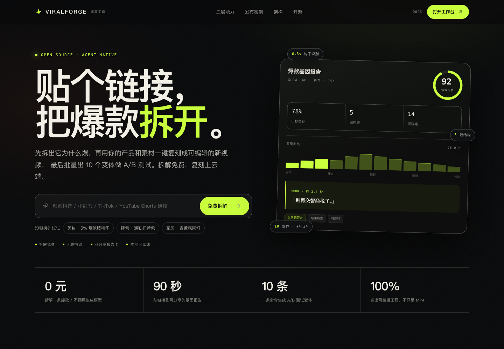
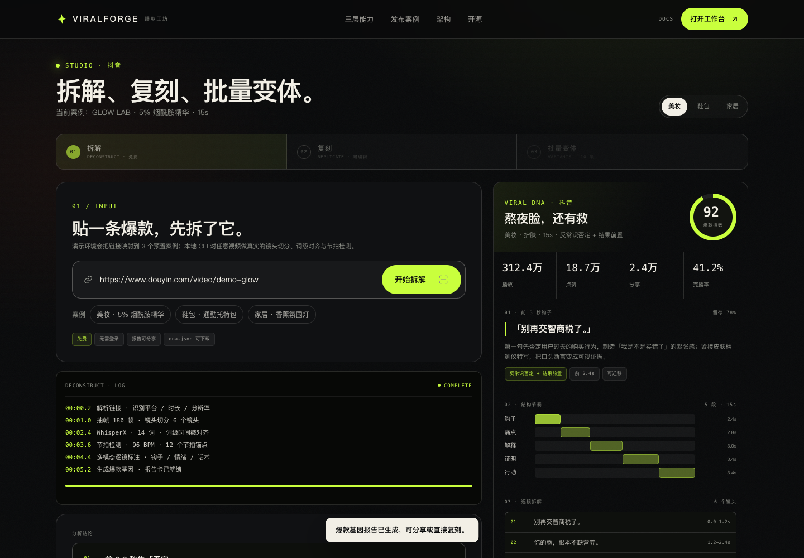

<p align="center">
  
</p>

<h3 align="center">Deconstruct any viral video. Replicate the structure. Ship 10 variants.</h3>

<p align="center">
  <a href="#quickstart"><strong>Quickstart</strong></a> ·
  <a href="#how-it-works"><strong>How it works</strong></a> ·
  <a href="#the-three-layers"><strong>Three layers</strong></a> ·
  <a href="./README.zh-CN.md"><strong>简体中文</strong></a>
</p>

<p align="center">
  
  
  
</p>

> Paste a viral link → get a **Viral DNA report** → replace the product and script → get an **editable project**, not just an MP4 → generate **10 costed variants** for A/B testing.

**ViralForge** is an agent-native short-video studio. It is not another black-box generator: it
explains *why* a video holds attention, keeps that structure in an editable format, and makes the
cost of every variant explicit.

The demo runs entirely on pre-rendered, self-made assets — no model key required. Structural
analysis (shot cuts, BPM, pacing) is computed locally and is real.





---

## Why

Merchants and operators already deconstruct viral videos by hand: pause on the first 3 seconds,
guess the hook, note the shot rhythm, copy the caption, find the BGM, re-shoot with their product.
It takes hours, depends on taste, and the conclusion stays in one person's head.

The hard part is not editing. It is **not knowing what will work**. ViralForge turns that tacit
knowledge into a shareable, structured, editable asset.

| | Generic AI video | Template editors | ViralForge |
| --- | --- | --- | --- |
| Starting point | Prompt | Template | A real viral reference |
| Explains why it works | No | No | **Viral DNA report** |
| Output | Opaque MP4 | Fixed template | **Editable VFML project** |
| Scale | One at a time | Manual | **10 costed variants** |
| Product consistency | No | No | Reference-image lock per shot |

---

## The three layers

### 01 · Deconstruct — free, offline

Shot cuts (OpenCV / PySceneDetect), word-level alignment (WhisperX, optional), BGM beat detection
(librosa in the full pipeline), multimodal annotation. Output: hook, rhythm curve, caption style,
beat anchors, emotional curve, conversion lines — plus a **shareable report card** and `dna.json`.

### 02 · Replicate — the paid gate

Keep the structure; replace the product, script, voice and licensed avatar. Shots are anchored to
**words, not seconds**. Reference images lock the product across shots. Output is a `project.json`
(VFML) plus assets, subtitles and a shot list — not only an MP4.

### 03 · Variants — scale

One command, 10 versions across hook × audience × scene. Only dirty shots are regenerated,
rendering is parallelized per shot, and every variant carries a model / shot / time / cost ledger.

---

## How it works

```
Input: viral link / local video + product image, selling points, material
        │
        ▼
① Deconstruct (free, offline)
   frames + audio → shot cuts → word alignment → beat detection → multimodal annotation
        │
        ▼
Viral DNA JSON (VFML.dna) ──▶ shareable report card (free)
        │
        ▼
② Replicate (paid)
   keep structure, replace product / script / voice / licensed avatar
   product reference lock + word-anchor reflow + selective regeneration
        │
        ├──────────────▶ WearAI Cloud
        │                category recipes · hosted models ·
        │                product/character consistency · batch & multilingual
        ▼
③ Generate (pluggable models) → ④ Render (FFmpeg, parallel, AI labels)
        │
        ▼
Output: editable VFML project + MP4 + per-variant cost ledger
```

---

## Quickstart

```bash
git clone <this-repo> viralforge
cd viralforge
npm install
npm run dev          # http://127.0.0.1:5173
```

Build and preview:

```bash
npm run build
npm run preview      # http://127.0.0.1:4173
```

Re-render the three demo films (requires FFmpeg and a running dev server):

```bash
npm run render       # → public/media/*.mp4 + covers
```

Analyze your own local video (no API key). Requires FFmpeg, Python 3.10+,
`numpy` and `opencv-python` (`pip install -r scripts/requirements.txt`):

```bash
node cli/viralforge.mjs analyze ./reference.mp4 --out dna.json
node cli/viralforge.mjs report dna.json
```

> Prefer local uploads. Downloading platform videos may violate their terms; ViralForge never
> redistributes the reference footage.

### MCP

```json
{
  "mcpServers": {
    "viralforge": {
      "command": "node",
      "args": ["/absolute/path/to/viralforge/mcp/server.mjs"]
    }
  }
}
```

Tools: `list_cases`, `get_case`, `analyze_video`, `build_project`.
Skill: [`skills/viralforge/SKILL.md`](./skills/viralforge/SKILL.md).

---

## VFML: word-anchored video projects

Words are the anchor; seconds are a result. Change a line and the shots, captions and voice
re-flow together.

```json
{
  "version": "0.1",
  "meta": { "title": "熬夜脸，还有救", "ratio": "9:16", "duration": 15, "aiDisclosure": true },
  "productRefs": [{ "id": "serum", "lock": ["logo", "color", "shape"] }],
  "words": [
    { "text": "别再", "start": 0.2, "end": 0.6 },
    { "text": "交智商税了", "start": 0.6, "end": 1.1 }
  ],
  "shots": [{
    "id": "s1",
    "wordRange": [0, 3],
    "visual": "macro-skin",
    "productLock": true,
    "caption": "别再交智商税了。",
    "dirty": false
  }],
  "render": { "engine": "ffmpeg", "fps": 30, "parallelism": 4 }
}
```

`dirty` marks the shots that need regeneration. That is what keeps 10 variants affordable.

---

## Demo cases

| Case | Category | Hook | Score |
| --- | --- | --- | --- |
| [Glow Lab](./src/data/cases.ts) | Beauty · serum | “别再交智商税了。” | 92 |
| [AER](./src/data/cases.ts) | Bags · tote | “能装下 14 寸电脑的包，都长得像去开会。” | 89 |
| [MORI](./src/data/cases.ts) | Home · ambient lamp | “房东的破出租屋，被我 30 块改了。” | 94 |

Each case ships with reference stills (self-made simulations), a full DNA report, a rendered
replica film and 10 variants with costs. Switch cases inside the studio.

---

## Open source vs cloud

| Capability | Open source | WearAI Cloud |
| --- | --- | --- |
| Skill / CLI / MCP | ✅ | — |
| Deconstruct engine + report format | ✅ | batch, multilingual |
| FFmpeg composition pipeline | ✅ | hosted render queue |
| Reference-image product lock | ✅ template constraint | consistency model |
| Small local batches | ✅ | large batches, cost optimization |
| Category recipes / template library | ❌ | ✅ 8 categories |
| Hosted models | bring your own key | ✅ 33 models |
| Character consistency | ❌ | ✅ |
| Team spaces / billing | ❌ | ✅ |

The cloud side is where replication and batch generation become a paid product. The open-source
side is the free, shareable entry point.

---

## Compliance

- Replicate **structure and rhythm**, not footage, music or the original script.
- Reference footage is analyzed only; it never enters the output.
- **No face swap.** Only the user's own or licensed avatars.
- Every output carries an explicit on-frame and metadata **AI-generated** label.
- Demo stills are self-made simulations; BGM is synthesized locally.
- Prefer local uploads; platform terms are respected.

See [`docs/PLAN.md`](./docs/PLAN.md) §14 for the full risk register.

---

## Repository layout

```
src/                  Web studio (Vite + React + TS)
src/render/           Film render template (DOM → frames)
scripts/              analyze.py, make_audio.py, render-cases.mjs
public/media/         Three rendered films + covers
cli/                  viralforge CLI
mcp/                  MCP stdio server
skills/viralforge/    Agent Skill
tests/                E2E, media, MCP tests
docs/                 PLAN, IMPLEMENTATION, OPEN-QUESTIONS
```

## Test

```bash
npm run typecheck
npm run build
npm run test        # Playwright E2E
npm run test:media  # ffprobe checks on the 3 films
npm run test:mcp    # MCP handshake, tools/list, tools/call
```

## Demo script

A 3-minute click path (and what to say on each beat) is in [`docs/DEMO.md`](./docs/DEMO.md).

## Status

**MVP.** The demo's semantic insights are curated, the replica films are pre-rendered, and batch
variants produce scripts/covers/cost estimates. Model calls and batch rendering require a key or
a worker. Everything else — the studio, analysis CLI, report pages, VFML export, cost ledger —
runs end to end.

## License

Apache-2.0. See [LICENSE](./LICENSE).

### A note on prior art

ViralForge does **not** include or derive from Hypit code. Hypit's custom license restricts
multi-tenant SaaS and commercial redistribution; we only adopt the publicly discussed idea of
word-anchored video authoring, with our own implementation. No AGPL dependencies. Remotion and
HyperFrames are intentionally not used; the renderer is Playwright + FFmpeg so commercial licensing
can be reviewed separately.

---

<p align="center"><em>Clone the structure. Not the footage.</em></p>
