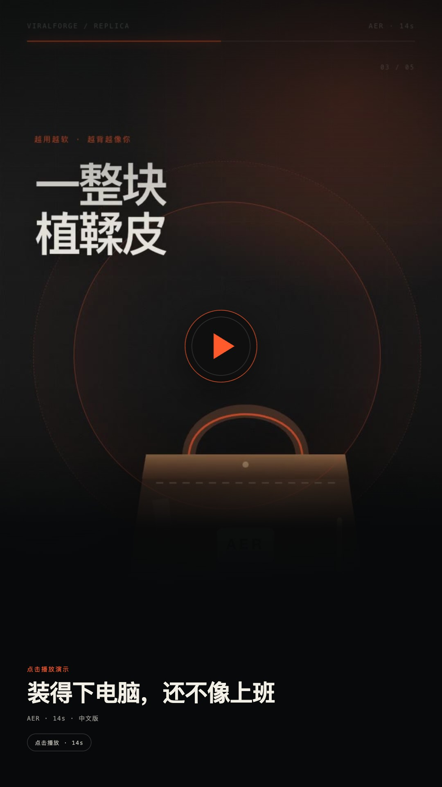

<p align="center">
  
</p>

<h3 align="center">一键复刻爆款短视频。<br/>拆解脚本，保留结构，批量出 10 个变体。</h3>

<p align="center">
  <a href="#快速开始"><strong>快速开始</strong></a> ·
  <a href="#案例"><strong>案例</strong></a> ·
  <a href="#agent-native"><strong>Agent</strong></a> ·
  <a href="#工作方式"><strong>工作方式</strong></a> ·
  <a href="./README.md"><strong>English (default)</strong></a>
</p>

<p align="center">
  <a href="https://github.com/fendouai/ViralForge/blob/main/LICENSE"></a>
  
  
  
</p>

> 贴一个爆款视频链接 → 拆出「爆款基因报告」→ 用你的产品和脚本一键复刻 → 得到可编辑工程，而不是一条黑盒 MP4 → 批量出 10 个标好成本的变体。

**ViralForge 是一个 Agent-native 的短视频拆解与复刻工作台。** 它先回答「这条视频为什么能留住人」，
再把钩子、逐镜结构、词级锚点、节拍、字幕、情绪曲线和转化话术变成一份可分享的 **爆款基因报告**；
然后用你的产品与脚本 **一键复刻** 同一套结构，输出可编辑的 VFML 工程；最后生成 **10 个带成本的变体**
做 A/B 测试。

**关键词：** 爆款短视频复刻 · 视频脚本拆解 · 一键复刻 · AI Agent · MCP · VFML · FFmpeg · UGC 广告

英文是默认文档语言：**[README.md](./README.md)**。


---

## 看演示

三条 13–15 秒中文成片。点封面直接在浏览器播放，无需登录，也不搬运平台原片。

<p align="center">
  <a href="https://cdn.jsdelivr.net/gh/fendouai/ViralForge@main/public/media/glow.mp4"></a>
  <a href="https://cdn.jsdelivr.net/gh/fendouai/ViralForge@main/public/media/tote.mp4"></a>
  <a href="https://cdn.jsdelivr.net/gh/fendouai/ViralForge@main/public/media/lamp.mp4"></a>
</p>

<p align="center"><sub>GLOW LAB · 15s &nbsp;·&nbsp; AER · 14s &nbsp;·&nbsp; MORI · 13s</sub></p>

想看拆解逻辑？完整 DNA、复刻脚本和 10 个变体在[案例](#案例)。所有成片均为自制素材并带 AI 标识；
参考片只用于分析，不进入成片。

---

## 为什么

商家和运营每天都在手工拆解爆款：暂停在前 3 秒、猜钩子、记镜头、抄文案、找 BGM、用自己的产品翻拍。
耗时、依赖经验，结论还留在个人脑子里。最大的问题不是「不会剪」，而是「不知道什么会火」。

ViralForge 把这套隐性知识变成可分享、可结构化、可编辑的资产，并让整条链路可以被 Agent 调用。

| | 通用 AI 视频 | 模板剪辑 | ViralForge |
| --- | --- | --- | --- |
| 起点 | 提示词 | 模板 | 一条真实爆款 |
| 解释为什么火 | 否 | 否 | **爆款基因报告** |
| 拆解视频脚本 | 否 | 否 | **钩子、节拍、词锚点、可迁移公式** |
| 产物 | 黑盒 MP4 | 固定模板 | **可编辑 VFML 工程** |
| 规模 | 一条条做 | 手动 | **10 条带成本变体** |
| Agent 可调用 | 很少 | 否 | **Skill + MCP + CLI** |
| 商品一致性 | 否 | 否 | 逐镜参考图锁定 |

---

## 案例

三个完整演示案例。每个案例都展示参考片 DNA、复刻脚本和变体矩阵。参考片为自制模拟，复刻成片为本地
预渲染；指标为演示固定值，用于说明报告格式，不代表客户投放结果。

| # | 案例 | 品类 | 钩子 | 基因分 | 复刻 |
| --- | --- | --- | --- | --- | --- |
| 01 | [GLOW LAB](#case-01) | 美妆 · 精华 | 「别再交智商税了。」 | 92 | 15s · ¥1.86 |
| 02 | [AER](#case-02) | 鞋包 · 托特 | 「能装下 14 寸电脑的包，都长得像去开会。」 | 89 | 14s · ¥1.72 |
| 03 | [MORI](#case-03) | 家居 · 氛围灯 | 「房东的破出租屋，被我 30 块改了。」 | 94 | 13s · ¥1.64 |

<a name="case-01"></a>
### 案例 01 · GLOW LAB：15 秒精华种草片，换成另一个产品

**参考片：** 抖音 · 15s · 96 BPM · 312.4 万播放 · 18.7 万点赞 · 41.2% 完播 · 78% 3 秒留存

**钩子：** 「别再交智商税了。」反常识否定 + 结果前置。

**基因报告说了什么**

- 前 0.8 秒先否定用户过去的购买行为，制造「我是不是买错了」的紧张感；紧接着皮肤检测仪特写，
  把口头断言变成可视证据。
- 产品第 5 秒才出现。前 5 秒用痛点占住注意力，产品只负责「解释」，不负责「留人」。
- 字幕比口播早约 0.2 秒，观众先看到字、再听到声，制造「我先知道了」的优越感。
- 结尾不喊「快买」，而是「先领小样」，把决策成本降到最低。

**可迁移公式：** 反常识否定 → 三个具体痛点 → 单一成分证据 → 7 天前后对比 → 低门槛行动。

**复刻脚本**

| 时间 | 台词 | 镜头 |
| --- | --- | --- |
| 0.0–2.4s | 别再往脸上堆瓶瓶罐罐了。 | 检测仪怼脸，硬光 |
| 2.4–5.2s | 熬夜、卡粉、没光，问题不在粉底。 | 三个痛点快切 |
| 5.2–8.2s | 5% 烟酰胺，微囊包裹，慢慢释放。 | 产品入场，环绕 |
| 8.2–11.6s | 第 1 天，和第 7 天。 | 左右分屏对比 |
| 11.6–15s | 先领小样，再决定。 | 中景，光晕 CTA |

<details>
<summary><strong>全部 10 个变体与成本</strong>（合计 ¥4.34）</summary>

| # | 钩子 | 角度 | 人群 | 成本 |
| --- | --- | --- | --- | --- |
| 01 | 别再交智商税了 | 反常识否定 | 成分党 | ¥0.42 |
| 02 | 熬夜到 3 点，第二天像睡了 8 小时 | 结果前置 | 熬夜党 | ¥0.51 |
| 03 | 皮肤科医生不会告诉你的 1 个成分 | 权威悬念 | 成分党 | ¥0.38 |
| 04 | 300 块的精华，和 30 块的差在哪 | 价格对比 | 学生党 | ¥0.46 |
| 05 | 卡粉不是粉底的错 | 归因反转 | 干皮 | ¥0.33 |
| 06 | 我把检测仪怼在脸上，结果… | 实验测评 | 理性党 | ¥0.55 |
| 07 | 7 天，只改了这一件事 | 挑战记录 | 懒人 | ¥0.49 |
| 08 | 敏感肌先别买，看完再说 | 风险提示 | 敏感肌 | ¥0.36 |
| 09 | 男朋友以为我去做了项目 | 社交证明 | 约会人群 | ¥0.44 |
| 10 | 早八人 3 分钟出门的秘密 | 场景效率 | 通勤族 | ¥0.40 |

</details>

---

<a name="case-02"></a>
### 案例 02 · AER：14 秒托特包带货片，围绕 14 寸电脑重写

**参考片：** 小红书 · 14s · 112 BPM · 186.2 万播放 · 12.1 万点赞 · 38.6% 完播 · 74% 3 秒留存

**钩子：** 「能装下 14 寸电脑的包，都长得像去开会。」身份反差 + 具体数字。

**基因报告说了什么**

- 用「14 寸」代替「大容量」：具体数字比形容词可信，打工人只需要确认自己的电脑装得下。
- 先承认刻板印象，再打破它。「都像去开会」替用户说出偏见，后面的反差才成立。
- 植鞣皮、走线、五金三个微距镜头负责溢价，把「一百多块的包」讲出轻奢质感。
- 通勤、出差、带娃三个场景对应三类人，评论区自然分成三派，互动率被拉高。

**可迁移公式：** 身份反差 → 三个具体场景 → 材质 / 分区细节 → 一包三用 → 颜色收尾。

**复刻脚本**

| 时间 | 台词 | 镜头 |
| --- | --- | --- |
| 0.0–2.6s | 能装下 14 寸电脑的包，都长得像去开会。 | 电脑塞进包，俯拍 |
| 2.6–5.4s | 直到我背了这只。通勤、出差、带娃。 | 三场景连切 |
| 5.4–8.4s | 一整块植鞣皮，越用越软。 | 皮质微距，侧光 |
| 8.4–11.4s | 13 个分区，电脑还有独立层。 | 分区展示，手部 |
| 11.4–14s | 三个颜色，通勤直接背。 | 三色平推 |

<details>
<summary><strong>全部 10 个变体与成本</strong>（合计 ¥4.21）</summary>

| # | 钩子 | 角度 | 人群 | 成本 |
| --- | --- | --- | --- | --- |
| 01 | 装得下 14 寸电脑，还不像去上班 | 身份反差 | 通勤族 | ¥0.44 |
| 02 | 通勤包，我只留这一只 | 极简选择 | 极简党 | ¥0.35 |
| 03 | 13 个分区，找钥匙不用翻 | 细节痛点 | 收纳控 | ¥0.39 |
| 04 | 出差 3 天，一只包够了 | 场景效率 | 差旅党 | ¥0.47 |
| 05 | 当妈以后，包反而变小了 | 身份反转 | 宝妈 | ¥0.43 |
| 06 | 植鞣皮，越用越像你的 | 材质故事 | 质感党 | ¥0.52 |
| 07 | 小个子背大包，居然不压身高 | 身材顾虑 | 小个子 | ¥0.38 |
| 08 | 面试背它，HR 以为我很贵 | 社交证明 | 职场新人 | ¥0.46 |
| 09 | 下雨天，电脑还在包里 | 风险场景 | 雨天通勤 | ¥0.41 |
| 10 | 一只包，三种背法 | 一物多用 | 实用党 | ¥0.36 |

</details>

---

<a name="case-03"></a>
### 案例 03 · MORI：13 秒出租屋改造，30 块氛围灯

**参考片：** 抖音 · 13s · 72 BPM · 428.9 万播放 · 26.3 万点赞 · 44.1% 完播 · 81% 3 秒留存

**钩子：** 「房东的破出租屋，被我 30 块改了。」价格反差 + 改造叙事。

**基因报告说了什么**

- 「房东的破出租屋」是强身份共鸣，「30 块」是价格钩子，「被我改了」是结果承诺，一句话完成三个信息。
- 开关灯是天然的前后对比，不需要滤镜和布景，一个开关就是最强的视觉证据。
- 价格在钩子里就给了。30 块不是结尾促销，而是开头的好奇心；价格越早出现，越像分享而不是广告。
- 卖的是睡前 10 分钟，不是三档光。用户记住的不是参数，是「房间先安静下来」的那口气。

**可迁移公式：** 价格反差 → 关灯 / 开灯对比 → 三个具体功能 → 睡前场景 → 低客单行动。

**复刻脚本**

| 时间 | 台词 | 镜头 |
| --- | --- | --- |
| 0.0–2.2s | 房东的破出租屋，被我 30 块改了。 | 广角，冷光 |
| 2.2–4.8s | 只开了一盏灯。关灯，和开灯。 | 开关瞬间，暖光 |
| 4.8–8.0s | 三档暖光，无极调光，还能定时。 | 功能微距，手部 |
| 8.0–10.8s | 睡前 10 分钟，房间先安静。 | 床头场景，慢推 |
| 10.8–13s | 30 块，先买氛围。 | 静物，光晕 |

<details>
<summary><strong>全部 10 个变体与成本</strong>（合计 ¥4.10）</summary>

| # | 钩子 | 角度 | 人群 | 成本 |
| --- | --- | --- | --- | --- |
| 01 | 30 块，把出租屋改成样板间 | 价格反差 | 租房党 | ¥0.40 |
| 02 | 不开大灯的第 7 天，电费少了 | 结果记录 | 独居 | ¥0.45 |
| 03 | 睡前 10 分钟，房间先安静 | 情绪场景 | 失眠党 | ¥0.37 |
| 04 | 房东不让我刷墙，我买了它 | 限制反转 | 租房党 | ¥0.42 |
| 05 | 独居女生，一定要有一盏暖光 | 身份召唤 | 独居女性 | ¥0.39 |
| 06 | 拍照不用滤镜，是灯的原因 | 结果证明 | 拍照党 | ¥0.48 |
| 07 | 三档光，三种情绪 | 功能可视化 | 氛围党 | ¥0.34 |
| 08 | 合租也能拥有自己的角落 | 空间痛点 | 合租党 | ¥0.41 |
| 09 | 送朋友，她以为要 300 | 社交证明 | 送礼 | ¥0.46 |
| 10 | 关灯那一刻，班味散了 | 情绪释放 | 打工人 | ¥0.38 |

</details>

---

## Agent-native

ViralForge 不是「UI 旁边挂个 API」。整套工作台本身就是一组 Agent 工具：Skill 教 Agent 何时以及如何
调用，MCP 暴露工具，CLI 负责本地执行，每一步都产出机器可读的文件。

**Claude Code、Codex、Cursor、OpenClaw 或任意 MCP 客户端都可以直接驱动。**

| 入口 | Agent 得到什么 | 位置 |
| --- | --- | --- |
| **Skill** | 工作流、输出风格、边界与合规约束 | [`skills/viralforge/SKILL.md`](./skills/viralforge/SKILL.md) |
| **MCP** | `list_cases`、`get_case`、`analyze_video`、`build_project` | [`mcp/server.mjs`](./mcp/server.mjs) |
| **CLI** | 可复现的本地分析、报告与渲染 | `viralforge analyze / report / render` |
| **产物** | DNA JSON、VFML 工程、变体 CSV、成本账单 | `dna.json`、`project.vfml.json` |

### 一次 Agent 会话

```text
> 用 ViralForge 拆解 ./reference.mp4，保留结构，换成我的精华，出 10 个变体。

get_case glow                  -> 钩子 + 可迁移公式（演示 DNA）
analyze_video ./reference.mp4  -> 6 个镜头 · 96 BPM · 平均 2.3s
build_project glow             -> project.vfml.json · 6 个镜头 · 14 个词锚点
                                  10 个变体 · 预估 ¥4.34
```

Agent 可以检查 DNA、决定保留什么、改写脚本、锁定商品参考图、标记 dirty 镜头并导出变体矩阵。
不需要浏览器自动化，也不需要屏幕抓取。

### 安装 Skill

```bash
mkdir -p .claude/skills
cp -R skills/viralforge .claude/skills/viralforge
```

然后对 Agent 说：*「用 viralforge skill 拆解 ./reference.mp4，并换成我的产品。」*

### MCP

```json
{
  "mcpServers": {
    "viralforge": {
      "command": "node",
      "args": ["/absolute/path/to/viralforge/mcp/server.mjs"]
    }
  }
}
```

### CLI

```bash
viralforge analyze ./reference.mp4 --out dna.json
viralforge report dna.json
viralforge cases
viralforge render glow
```

---

## 快速开始

```bash
git clone https://github.com/fendouai/ViralForge.git
cd ViralForge
npm install
npm run doctor      # 可选：检查本机依赖
npm run dev         # http://127.0.0.1:5173
```

打开工作台，任选一个案例，走完 **拆解 → 复刻 → 10 个变体**。Demo 使用仓库内预渲染的自制素材；
结构分析（镜头切分、BPM、节奏）是本地真实计算。不需要任何模型或平台 API Key。

```bash
npm run build
npm run preview      # http://127.0.0.1:4173
npm run render       # 重新渲染 3 条成片（FFmpeg + dev server）
```

本地分析任意视频（无需 Key；需要 FFmpeg、Python 3.9+、`numpy`、`opencv-python-headless`）：

```bash
node cli/viralforge.mjs analyze ./reference.mp4 --out dna.json
node cli/viralforge.mjs report dna.json
```

> 优先本地上传。下载平台视频可能违反平台条款；ViralForge 不二次分发参考片。

### 依赖

| 依赖 | 是否必需 | 用途 |
| --- | --- | --- |
| Node.js 22.15+ | 是 | Web 应用 / 构建 |
| npm | 是 | 安装依赖 |
| FFmpeg + ffprobe | 可选 | 重新渲染、媒体校验、CLI 分析 |
| Python 3.9+ / numpy / opencv-python-headless | 可选 | `viralforge analyze` |
| Chromium（Playwright） | 可选 | 重新渲染、E2E 测试 |
| 模型 / 平台 API Key | 否 | — |

代码不读取 `OPENAI_API_KEY`、`DASHSCOPE_API_KEY`、平台 Cookie 或任何 `VITE_*` 密钥。
详细说明见 [`docs/LOCAL-SETUP.md`](./docs/LOCAL-SETUP.md)。

---

## 工作方式

### 01 · 拆解 —— 免费、可离线

镜头切分（OpenCV / PySceneDetect）、词级对齐（WhisperX，可选）、BGM 节拍检测（librosa）、
多模态标注。输出钩子、节奏曲线、字幕风格、卡点、情绪曲线、转化话术，以及可分享报告卡和 `dna.json`。

### 02 · 复刻 —— 一键重建

保留结构，替换产品、脚本、配音、授权数字人。镜头锚定 **词**，而不是秒数；商品参考图锁每个镜头。
输出 VFML 工程 + 素材 + 字幕 + 分镜表，而不只是一条 MP4。

### 03 · 变体 —— 规模化

一条命令 10 个版本，覆盖钩子 × 人群 × 场景。只重新生成 dirty 镜头，镜头级并行，每条都带模型 /
镜头 / 耗时 / 成本账单。

---

## VFML：以词为锚点的视频工程

词是锚点，秒是结果。改一句台词，镜头、字幕和配音一起重排。

```json
{
  "version": "0.1",
  "meta": {
    "title": "熬夜脸，7 天有光",
    "ratio": "9:16",
    "duration": 15,
    "aiDisclosure": true
  },
  "productRefs": [{ "id": "serum", "lock": ["logo", "color", "shape"] }],
  "words": [
    { "text": "别再", "start": 0.2, "end": 0.6 },
    { "text": "交智商税了", "start": 0.6, "end": 1.1 }
  ],
  "shots": [
    {
      "id": "s1",
      "wordRange": [0, 3],
      "visual": "scanner-closeup",
      "productRef": "serum",
      "caption": "别再交智商税了。",
      "dirty": false
    }
  ],
  "render": { "engine": "ffmpeg", "fps": 30, "parallelism": 4 }
}
```

`dirty` 标记需要重新生成的镜头，这是 10 个变体仍然便宜的原因。工程文件可 diff、可评审，也可以在
开源渲染器和云端 worker 之间迁移。

---

## 开源与云端

| 能力 | 开源 | WearAI 云端 |
| --- | --- | --- |
| Skill / CLI / MCP | 有 | — |
| 拆解引擎 + 报告格式 | 有 | 大批量、多语言 |
| FFmpeg 合成管线 | 有 | 托管渲染队列 |
| 商品参考图约束 | 有，模板级约束 | 一致性模型 |
| 本地小批量 | 有 | 大批量、成本优化 |
| 品类配方 / 模板库 | 无 | 有，8 大品类 |
| 托管模型 | 自带 Key | 33 个托管模型 |
| 角色一致性 | 无 | 有 |
| 团队空间 / 计费 | 无 | 有 |

云端负责把复刻与批量生成变成付费产品；开源负责做免费、可分享的入口。

---

## 合规

- 只复刻结构与节奏，不搬运原片画面、音乐、文案；
- 不做真人换脸，只用本人或授权数字人；
- 成片画面与元数据都加 AI 生成标识；
- 演示关键帧为自制模拟，BGM 为本地合成；
- 优先本地上传，尊重平台条款。

完整风险清单见 [`docs/PLAN.md`](./docs/PLAN.md) §14。

---

## 目录

```text
src/                  Web 工作台（Vite + React + TS）
src/render/           成片渲染模板（DOM -> 帧）
scripts/              analyze.py、make_audio.py、render-cases.mjs、render-demo-posters.mjs
public/media/         3 条成片 + 封面；en/ = 3 条英文成片
cli/                  viralforge CLI
mcp/                  MCP stdio server
skills/viralforge/    Agent Skill
tests/                E2E、媒体、MCP 测试
docs/                 PLAN、IMPLEMENTATION、OPEN-QUESTIONS
docs/en/              英文 README 视觉素材
docs/zh/              中文 README 成片封面
```

## 测试

```bash
npm run typecheck
npm run build
npm run test        # Playwright E2E
npm run test:media  # ffprobe 校验 3 条成片
npm run test:mcp    # MCP 握手、tools/list、tools/call
```

## 状态与路线图

**v0.1.0 · MVP。** Demo 的语义洞察为预置样例，复刻成片为预渲染，批量变体产出脚本、封面和成本估算；
模型调用与批量渲染需要 Key 或 worker。其余部分——工作台、分析 CLI、报告页、VFML 导出、成本账单——
已经端到端可运行。

- [x] 拆解、复刻、批量变体链路
- [x] Skill + MCP + CLI
- [x] 3 个完整演示案例，每个 10 个变体
- [x] VFML 导出与成本账单
- [ ] 英文工作台（当前 Demo 使用中文案例素材）
- [ ] WhisperX 词级对齐与多模态标注
- [ ] 视频 / 图像 / TTS 模型适配器
- [ ] 托管渲染队列与团队空间

已知边界：不实现平台链接下载，只支持本地上传；不做真人换脸；AI 生成标识始终开启；开源 Demo 的
语义层为预置样例，不是实时模型输出。

## 开源发布

- **版本：** v0.1.0 · 2026-11-11
- **许可证：** Apache-2.0
- **仓库：** `fendouai/ViralForge`
- [更新日志](./CHANGELOG.md) · [发布说明](./docs/RELEASE-NOTES-v0.1.0.md) · [发布流程](./docs/RELEASING.md)
- [贡献指南](./CONTRIBUTING.md) · [安全策略](./SECURITY.md) · [行为准则](./CODE_OF_CONDUCT.md)

发布包用 `npm run release:archive` 生成，只包含 git 跟踪的源码，不含 `node_modules` 和构建产物。

## 贡献

欢迎 Issue 和 PR。先读 [`CONTRIBUTING.md`](./CONTRIBUTING.md)，提交前运行 `npm run doctor` 和测试命令。
不做真人换脸，不使用未授权素材，不把密钥放进前端。

如果 ViralForge 帮你省了时间，点一个 Star 能让更多做内容的人找到它。

[](https://github.com/fendouai/ViralForge)

## 许可证

Apache-2.0。见 [LICENSE](./LICENSE)。

### 关于 prior art

ViralForge 不包含、也不派生自 Hypit 代码。Hypit 的自定义许可限制多租户 SaaS 与商业再分发；
本项目只借鉴公开讨论的「以词为锚点」思路并独立实现。无 AGPL 依赖，未使用 Remotion / HyperFrames；
渲染器为 Playwright + FFmpeg，便于单独审查商业许可。

---

<p align="center"><em>复刻结构，不搬运画面。</em></p>
